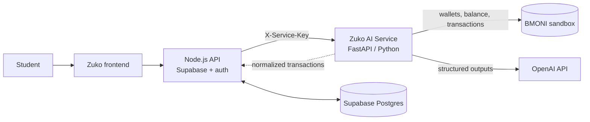

# BMONI Sandbox Investigation

**Owner:** Ono (Python / AI). **Status (16 Oct 2026):** ✅ Connected to the real sandbox. We have a partner API key, the health check passes, and the client, normalizer and mock now follow BMONI's actual OpenAPI spec. Zuko's demo student and CNGN wallet are created (section 0.3). Next: get test naira into the wallet.

## 0. Confirmed sandbox facts

- **Base URL (development):** `https://embedded-dev.bmoni.com`
- **API reference:** https://embedded-dev.bmoni.com/docs (OpenAPI JSON at `/docs/openapi.json`, "BMoni Embedded API 1.0")
- **Auth:** the partner key goes in the `x-api-key` header on every partner endpoint. Admin endpoints use a JWT, which we don't need.
- **⚠️ The key is shared.** It belongs to a single "BMONI Hackathon" partner, and `GET /v1/users` returns more than 1,000 users created by every team, including other teams' names, emails and phone numbers. Zuko must only ever read **its own** user ids, which we store in Supabase. Never list or show other users. The webhook config (`/v1/webhooks/config`) is shared too and points at BMONI's demo worker. **Don't change it**, because that would break webhooks for every team.
- **Data model:** partner → **users** → **smart wallets**, one per currency. These are on-chain stablecoin wallets: `CNGN` (naira), `USDB` (dollar), `CADC`, `EURe`, `GBPe`, `MEXe`.

### 0.1 Endpoints Zuko uses (read-only)

| Purpose | BMONI endpoint | Zuko route |
|---|---|---|
| Health | `GET /v1/health` | `GET /v1/bmoni/health` |
| List a user's wallets | `GET /v1/users/{userId}/smart-wallets/account/wallets` → `[{id, currency, walletAddress, isActive, …}]` | `GET /v1/bmoni/users/{user_id}/wallets` |
| Wallet balance | `GET /v1/users/{userId}/smart-wallets/{smartWalletId}/balance` → `{balance: "20", currency, smartWalletId}` | `GET /v1/bmoni/users/{user_id}/wallets/{wallet_id}/balance` |
| Transaction history | `GET /v1/users/{userId}/transactions/{smartWalletId}` → `{transactions: [{id, direction: incoming/outgoing, delta, amount, status, counterpartyName, purpose, note, narrationType, createdAt, …}], count}` | `GET /v1/bmoni/users/{user_id}/wallets/{wallet_id}/transactions` |
| All balances at once (alternative) | `GET /v1/users/{userId}/smart-wallets/account/balances` | not used yet |

How the normalizer handles these fields:
- `direction` decides debit or credit.
- `counterpartyName` becomes the merchant.
- `note` or `purpose` becomes the description; if both are empty, the description is built from `narrationType`.
- Transactions with status `failed`, `cancelled`, `expired` or `rejected` are dropped.
- Moves between the user's own wallets (`swap_between_wallets`, `fund_card`, `send_to_card`) are ignored.
- Fees (`service_fee`, card fees, `stamp_duty_naira`) are tagged as `other`.

### 0.2 Useful write endpoints (later, for the "matters to the product journey" criterion)

- `POST /v1/users/{userId}/signing-requests/transfers`: prepare a payment the user signs. This could power "Proceed" on the coach's affordability check.
- `POST /v1/users/{userId}/smart-wallets/account/send`: send from the user's wallet. Could be used for "Request ₦2,000 from roommates" or splits.
- `POST /v1/users/{userId}/smart-wallets/{id}/onramp/vba/nigeria`: link a Nigerian virtual bank account so allowance deposits land in CNGN.
- `POST /v1/users/{userId}/deposit/card`: fund a card from the wallet.
- Webhooks (`employee.deposit.completed`, etc.) for real-time alerts, though the webhook config is shared (see the warning above).

### 0.3 Zuko's demo student ✅ created 16 Oct 2026

- Fictional student "David Adeleke" (`zuko.demo.david.91031@example.com`), bmoniUserId `bc634f2d-6832-458b-b00b-88c3f32d301f`
- CNGN wallet `2372f8f8-43c3-48ea-aff8-31802328f7a5` (on-chain address `0xFA6A12Dfc53b7a70A4D1C1Fc2b1cBAD248E6a35e`), active, balance 0. The balance and list endpoints report its currency as `NGN`.
- Re-run or recreate with `scripts/bmoni_setup_demo.py`.

Gotchas we hit:
- **`{userId}` in every path is the user's `bmoniUserId`**, not the `id` returned at the top of the user record.
- Listing wallets for a user who has none returns **400** "No embedded smart wallet group found", not an empty list. The client treats this as "no wallets".

Steps the script performs:

1. `POST /v1/users` with `{firstName, email, phoneNumber}` (test persona, not real personal data). The response gives the BMONI `userId`. Store it as `BMONI_USER_ID`, and per student in Supabase.
2. `POST /v1/users/{userId}/smart-wallets/owner-proof-challenges` returns an EIP-191 message.
3. Sign the message with an EVM key the student "owns". For the demo this is a server-generated test key, kept secret.
4. `POST /v1/users/{userId}/smart-wallets/create-managed` with `{currency: "CNGN", userOwnerAddress, ownerProofChallengeId, ownerProofSignature}` creates the naira wallet.
5. Fund it with test money: link a Nigerian VBA (step 0.2), or use `POST /v1/users/{userId}/deposit/wallet` for a crypto deposit address. **Ask BMONI how to get test CNGN in the sandbox.**

## 1. What we found

**BMONI** is a Nigerian fintech that launched in October 2025. It offers multi-currency accounts (Naira and USD wallets) and virtual and physical Mastercards, and it works through licensed partner institutions rather than holding a banking licence itself. In interviews, BMONI has said it can provide KYC, fraud prevention and payments to partners "through our APIs". It has no public developer portal or API reference that we could find.

Sources:
- NITHUB hackathon page (rules, timeline, judging): https://nithub.unilag.edu.ng/hackathons
- TechCabal launch coverage: https://techcabal.com/2025/10/11/bmoni-launch-for-savings/
- Interview with BMONI's Head of Product (mentions APIs): https://consonanceclub.substack.com/p/inside-bmoni-ashwin-ravichandran

### Hackathon requirements (from the NITHUB page)

- BMONI is the sponsor. The theme is reimagining financial inclusion through AI.
- Each entry needs a **working, testable prototype with meaningful AI** and a **functional BMONI sandbox integration that matters to the product journey**.
- **Test data only.** Live funds and real personal financial data are prohibited.
- The judged work and the BMONI integration must be **built during the official build period**. Pre-existing code and third-party tools are allowed if declared.
- The sandbox docs and access process were **given to selected teams** (the page says they were released on API day, with a compulsory integration briefing and a technical check of sandbox access). The page doesn't link to them.
- The submission must include: an **architecture or data-flow diagram connecting AI and BMONI**, an explanation of the **endpoints and data flow used**, a list of models, APIs and tools, and a privacy, security and responsible-AI note.
- Judging (out of 100): BMONI integration **15%**, useful and responsible AI 15%, working prototype 20%, financial-inclusion value 20%, impact 15%, privacy, security and accessibility 10%, pitch 5%. **Ties are broken by inclusion impact, then prototype quality, then BMONI integration.**

> ⚠️ The page lists a July 2026 timeline, but today is 16 Oct 2026. Confirm which edition we're in and the current dates.

## 2. What Zuko needs from BMONI

| Need | Why | Zuko endpoint that uses it |
|---|---|---|
| List the user's wallets | Find the NGN wallet(s) | `GET /v1/bmoni/wallets` |
| Wallet balance | Real "Available Funds" instead of a typed-in number | `GET /v1/bmoni/wallets/{id}/balance` |
| Transaction history (date range, paginated) | Auto-log spending, which feeds the insights and the coach | `GET /v1/bmoni/wallets/{id}/transactions` |
| *(nice to have)* Webhooks for new transactions | Real-time "Velocity Alerts" | to add |
| *(nice to have)* Create a sub-wallet or vault, or a transfer | Make "Lock ₦8,000 earmark" and goal vaults move real (test) money | to add |

The last row would strengthen the "integration matters to the product journey" criterion. If the sandbox supports internal transfers or sub-wallets, the coach's "Earmark" and "Top up goal" one-tap actions can execute through BMONI.

## 3. How it's built



1. Node calls `GET /v1/bmoni/wallets/{id}/transactions` (or `POST /v1/bmoni/insights` for the dashboard).
2. `app/bmoni/client.py` calls BMONI, follows pagination and de-duplicates by id.
3. `app/bmoni/normalize.py` maps BMONI's fields to Zuko's `Transaction`. It handles kobo or naira amounts, DR/CR flags or signed amounts, and several date and narration field names. It also auto-categorizes the narration ("POS Mama Cass Cafeteria" becomes `food`).
4. Node upserts the transactions into Supabase on `(source='bmoni', id)`.
5. The insights engine and coach use them. The AI model only ever sees aggregates and narrations from **test** accounts.

Everything BMONI-specific is in env vars, so wiring up the real sandbox is configuration, not code:

```
BMONI_MODE=sandbox
BMONI_BASE_URL=https://<sandbox host>
BMONI_API_KEY=...            BMONI_SECRET_KEY=...
BMONI_AUTH_SCHEME=bearer     # or x-api-key / basic
BMONI_PATH_WALLETS=/...      BMONI_PATH_BALANCE=/.../{wallet_id}/...   BMONI_PATH_TRANSACTIONS=/.../{wallet_id}/...
BMONI_AMOUNT_UNIT=kobo       # if amounts come back in kobo
```

## 4. Testing the sandbox once we have access

1. Put the credentials and base URL in `ai-service/.env` and set `BMONI_MODE=sandbox`.
2. Run the probe: `.venv\Scripts\python -X utf8 scripts\bmoni_probe.py`. It tries the configured paths plus about 30 common ones, prints the status codes, follows up on the first wallet's balance and transactions, shows the normalized result, and saves everything to `docs/bmoni_probe_results.json`. The saved file never includes keys.
3. Update the `BMONI_PATH_*` values and, if needed, the field lists at the top of `app/bmoni/normalize.py`.
4. Add a test fixture with a real (test-data) payload in `tests/test_api.py` so the format is locked in.
5. Seed the sandbox wallet with a realistic month of student activity (allowance in, food, keke, data, handouts) so the demo tells a story.

Until then, `BMONI_MODE=mock` serves the same endpoints in-process (`app/bmoni/mock.py`) with relative dates, so the frontend and the Node team can build against them now.

## 5. Questions for the organizers / BMONI

1. Where are the sandbox docs, and how do we get API keys? Is it per team?
2. What's the base URL, and what's the auth scheme (bearer token, API key + secret, OAuth client credentials)? Do tokens expire?
3. Which endpoints are in scope for the sandbox: wallets, balances, transactions, transfers, virtual accounts, cards, webhooks?
4. Are amounts in **kobo or naira**? What's the date format and timezone?
5. How does pagination work (page/limit, cursor)? What are the rate limits?
6. Can we create test customers and wallets, and **simulate inflows and transactions** (e.g. a "fund wallet" or "simulate debit" endpoint)?
7. Are there **webhooks** for new transactions in the sandbox? How are they signed?
8. Can we create sub-wallets/vaults or do internal transfers (for earmarks and savings goals)?
9. What exactly counts as "meaningful" integration for the 15% criterion? Is read-only (balance + transactions) enough, or do they expect a write action?
10. Are there restrictions on sending sandbox data to third-party AI APIs (OpenAI)?
11. Confirm the edition and dates: the page shows July 2026.

## 6. Privacy and responsible-AI notes (for the submission)

- Only sandbox and test data is used. No live funds and no real personal financial data.
- BMONI and OpenAI credentials live in server-side env vars and never reach the browser. The probe output never includes keys.
- The Node backend authenticates to the AI service with a shared secret (`X-Service-Key`, compared in constant time).
- Request bodies aren't logged.
- Every number the AI coach shows is computed deterministically. The model explains figures but doesn't produce them. Each reply carries a `grounding` line, and amounts the AI parser can't find in the user's text are flagged for review.
- Parsed expenses are always shown for confirmation before they're saved. The AI never writes data.
- If the AI is unavailable or declines a request, the service falls back to rule-based parsing and template advice, so the app keeps working.
